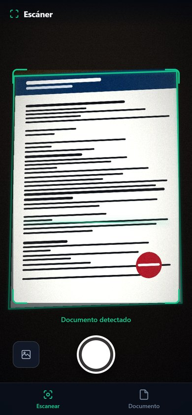
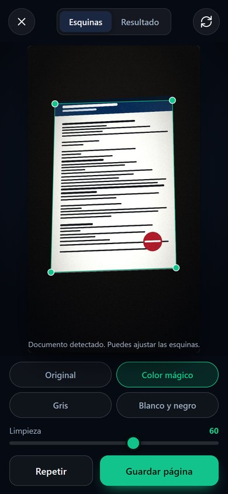
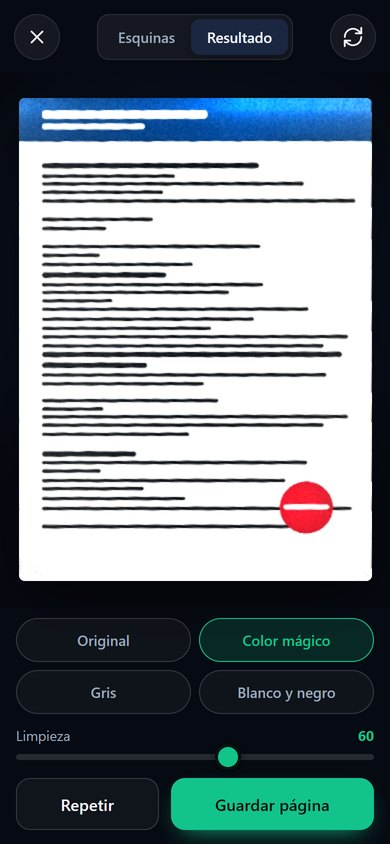
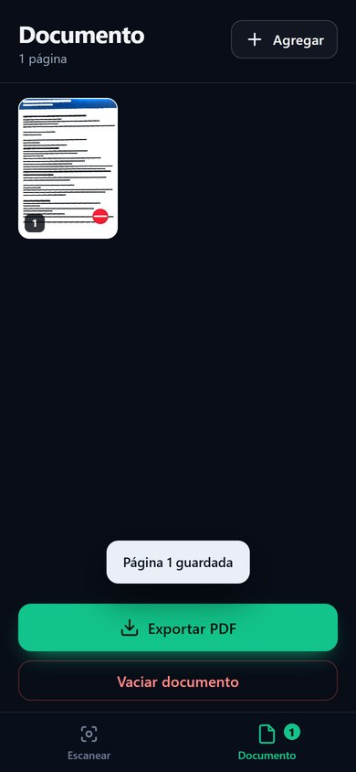
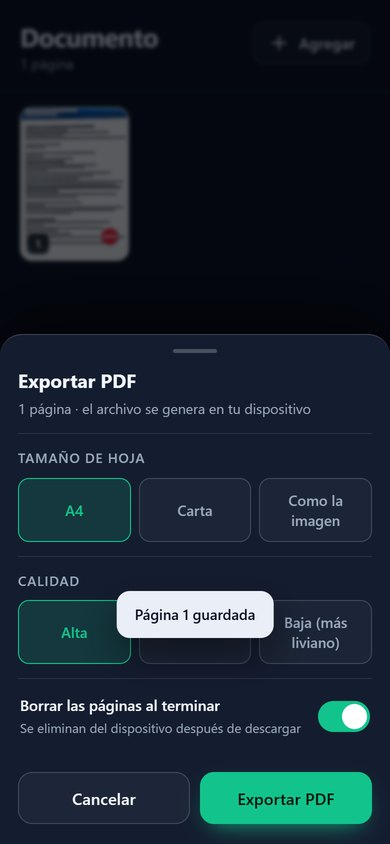
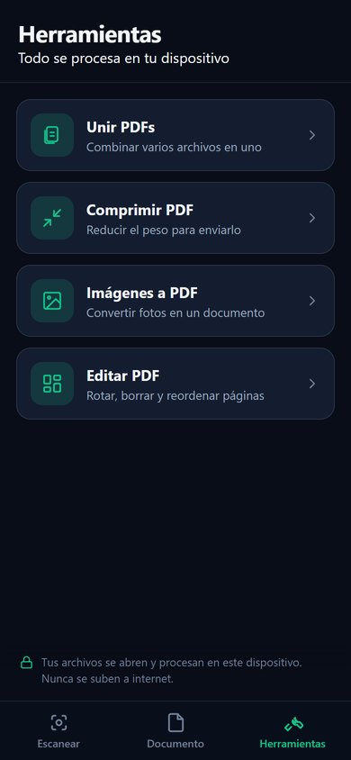
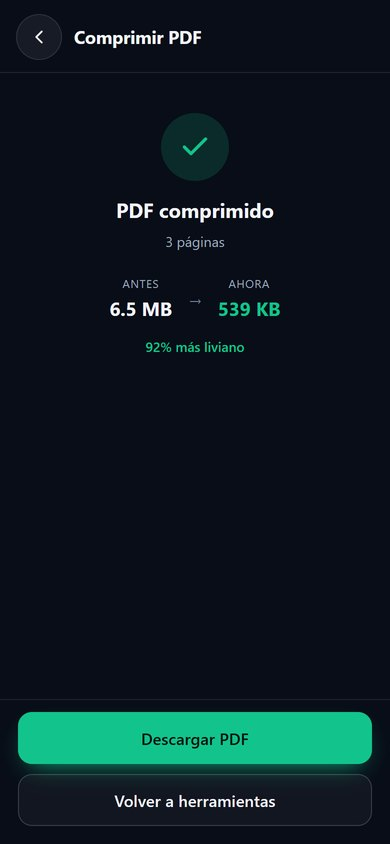
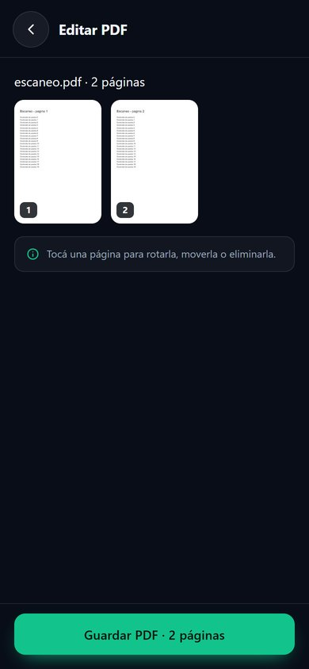

# Escáner de documentos

Aplicación web para escanear documentos con el teléfono y exportarlos a PDF.
Funciona **enteramente en el navegador**: las fotos no se suben a ningún
servidor, no hay cuentas, no hay base de datos remota.

Está pensada para usarse con una mano, en el celular, con botones grandes y
textos claros.

<p align="center">
  
  
  
</p>
<p align="center">
  
  
</p>

<p align="center">
  
  
  
</p>

---

## Qué hace

| Función | Detalle |
| --- | --- |
| Escanear con la cámara | Detecta el documento en vivo y dibuja su contorno en pantalla. |
| Tomar foto con la cámara del sistema | Alternativa cuando el navegador no da acceso a la cámara (iPhone viejo, permisos bloqueados). |
| Importar imágenes | Desde la galería del teléfono, una o varias a la vez. |
| Enderezar | Corrige la perspectiva y recorta el documento a partir de sus 4 esquinas. |
| Ajuste manual | Las esquinas se arrastran con el dedo; se ve el resultado en vivo. |
| Filtros | Original, Color mágico (quita sombras y deja el papel blanco), Gris y Blanco y negro. |
| Documento multipágina | Agregar, ver, rotar, reordenar y eliminar páginas. |
| Exportar PDF | A4, Carta o "como la imagen", con calidad alta/media/baja. Respeta la proporción real. |
| **Unir PDFs** | Combina varios archivos en uno, en el orden que elijas. |
| **Comprimir PDF** | Reduce el peso (hasta un 90 %) para enviarlo por correo o WhatsApp. |
| **Imágenes a PDF** | Convierte fotos sueltas en un documento, una por página. |
| **Editar PDF** | Abre un PDF y rota, borra o cambia de lugar sus páginas. |
| Sin conexión | Queda instalada como app (PWA) y funciona sin internet. |
| Guardado local | Las páginas se conservan en el dispositivo aunque se recargue la página. |

---

## Cómo se usa

1. Abrir la app y permitir el acceso a la cámara.
2. Encuadrar el documento dentro del recuadro. Cuando aparece el contorno verde,
   tocar el botón redondo.
3. Revisar las esquinas (se pueden arrastrar) y elegir el filtro en la pestaña
   **Resultado**.
4. Tocar **Guardar página**. Se vuelve a la cámara para escanear la siguiente.
5. En **Documento** se ven todas las páginas; al tocar una se puede rotar,
   mover o eliminar.
6. **Exportar PDF** descarga el archivo y, si está activada la opción, borra las
   páginas del dispositivo.

> Para agregar la app a la pantalla de inicio: en Android, menú ⋮ → "Instalar
> aplicación"; en iPhone, botón Compartir → "Agregar a pantalla de inicio".

---

## Privacidad

* No hay servidor: todo el procesamiento (enderezado, filtros, PDF) ocurre en el
  procesador del teléfono.
* Las páginas se guardan en el almacenamiento local del navegador
  (IndexedDB) para no perder el trabajo si se recarga la página.
* **Vaciar documento** elimina todo de forma definitiva. La exportación puede
  borrar automáticamente las páginas al terminar.
* No se usa ninguna librería de analítica ni se envía información a terceros.

---

## Publicar en GitHub Pages

El proyecto es 100 % estático: no hay que compilar nada.

```bash
git add .
git commit -m "Reconstrucción del escáner: detección, filtros y PDF"
git push origin main
```

Después, una sola vez:

1. En GitHub, abrir **Settings → Pages**.
2. En *Build and deployment*, elegir **Deploy from a branch**.
3. Branch: **main** — Carpeta: **/ (root)**. Guardar.
4. Esperar uno o dos minutos y abrir `https://<usuario>.github.io/Scan/`.

La cámara exige HTTPS: GitHub Pages ya lo provee. Si se abre el archivo
directamente (`file://`) la cámara no funciona; para probar en la computadora
hace falta un servidor local, por ejemplo:

```bash
python -m http.server 8000
# luego abrir http://localhost:8000
```

### Actualizaciones

La app guarda una copia para funcionar sin conexión. Cuando se publica una
versión nueva, el *service worker* la descarga en segundo plano. Si después de
actualizar se ve la versión anterior, recargar una vez más o borrar los datos
del sitio.

---

## Estructura

```
index.html              Estructura de las vistas (escanear, documento, editor, herramientas)
styles.css              Diseño completo
js/app.js               Cámara, vistas, páginas y exportación
js/imaging.js           Motor de imagen: homografía, filtros y detección
js/store.js             Guardado local con IndexedDB
js/pdf.js               Generación del PDF con jsPDF
js/tools.js             Herramientas: unir, comprimir, imágenes a PDF, editar
vendor/jspdf.umd.min.js jsPDF          (copia local, sin CDN)
vendor/pdf-lib.min.js   pdf-lib        (unir / editar páginas)
vendor/pdf.min.js       pdf.js         (renderizar páginas para comprimir)
vendor/pdf.worker.min.js
sw.js                   Service worker (uso sin conexión)
manifest.json           Metadatos de la app instalable
icons/                  Iconos
docs/                   Documentación técnica
tests/                  Pruebas del motor de imagen
```

Más detalle en [docs/arquitectura.md](docs/arquitectura.md).

---

## Pruebas

El motor de imagen se prueba con escenas sintéticas (documento sobre un
escritorio, con sombras, rotación y perspectiva). Resultado: error medio de
detección de **0,3 % de la diagonal** en 10 escenarios.

Ver [tests/README.md](tests/README.md).

---

## Roadmap

### Lo que ya está

Unir, comprimir, imágenes a PDF y edición de páginas. Todo en el navegador,
con las librerías (`pdf-lib` y `pdf.js`) cargadas **solo al abrir cada
herramienta**: la app de escaneo sigue pesando lo mismo.

### Lo que se podría sumar

| Función | Cómo | Nota |
| --- | --- | --- |
| Texto, firma o sello sobre el PDF | pdf-lib | Requiere una pantalla de edición nueva. |
| Numerar páginas / marca de agua | pdf-lib | Sencillo. |
| PDF → JPG | pdf.js | Sencillo, pero hay que resolver la descarga de varias imágenes. |
| OCR (texto buscable) | tesseract.js (~4 MB) | Lento en el teléfono; opcional. |
| Proteger con contraseña | pdf-lib | pdf-lib no encripta; habría que sumar otra librería. |

### App Android nativa

Solo tiene sentido si se necesita cámara de mejor calidad, OCR offline o
compartir directamente con otras apps. Con Capacitor se puede empaquetar esta
misma app en un APK sin reescribirla. No es necesario para el uso diario.
